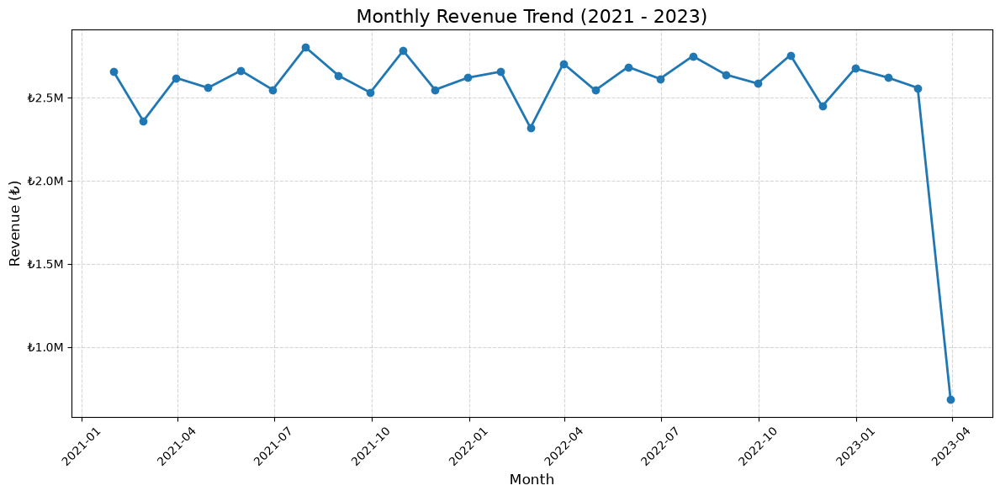
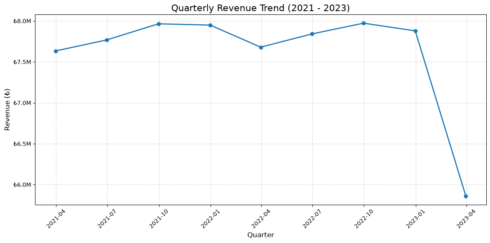
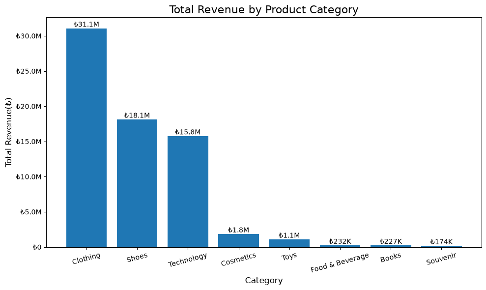
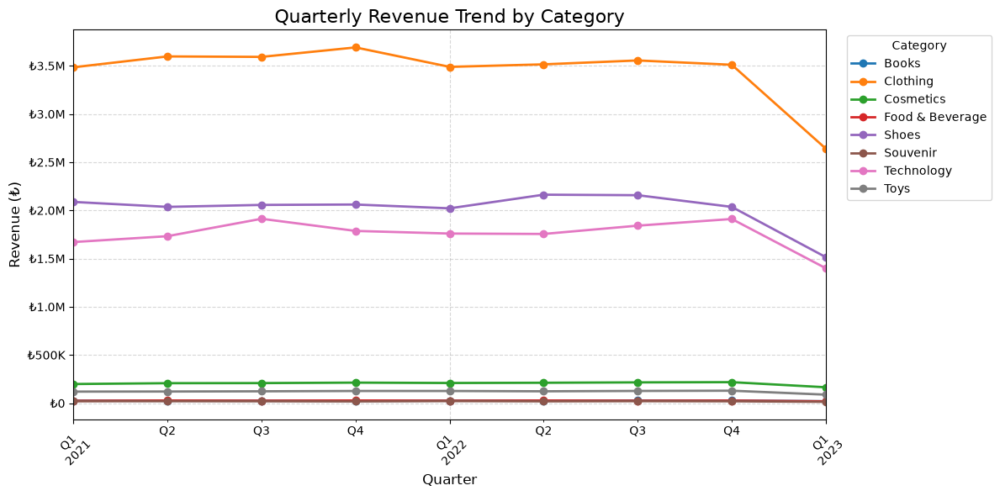
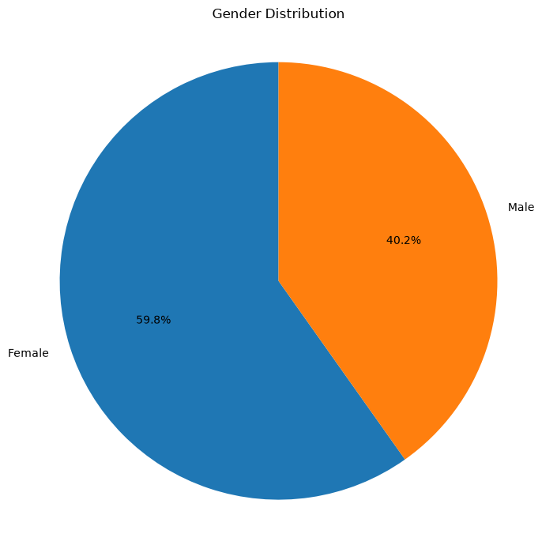
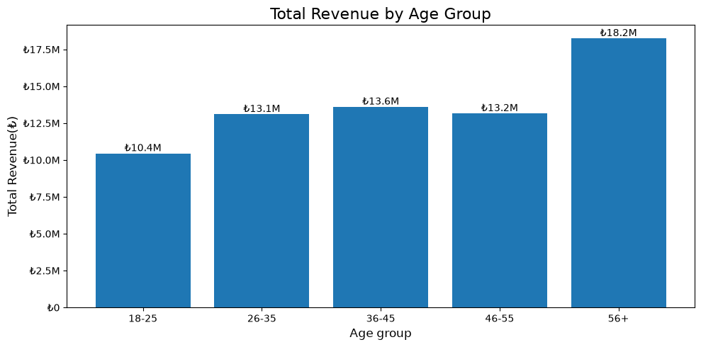
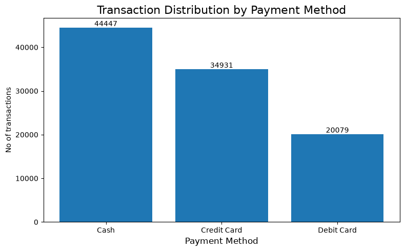
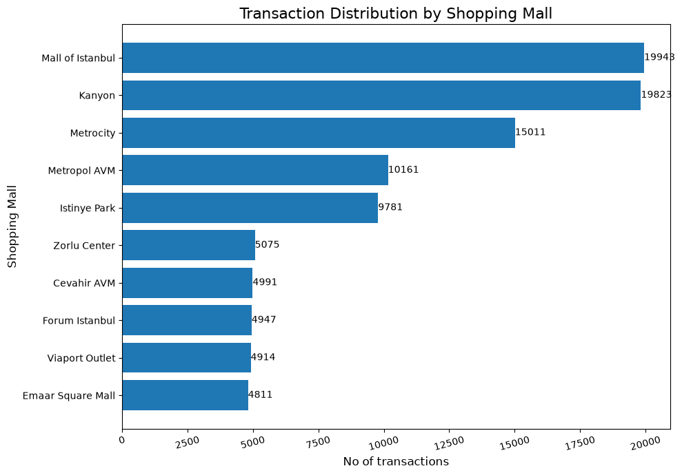
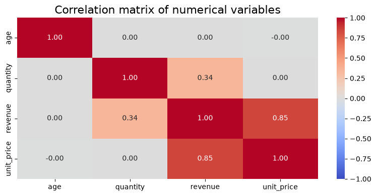

# Exploratory Data Analysis on Retail Sales Data

**Oasis Infobyte | AICTE OIB-SIP Data Analytics Internship | Level 1, Task 1**
---

## Project Overview
An end-to-end exploratory data analysis (EDA) of a shopping-mall retail dataset covering **99,457 transactions** across 10 Istanbul shopping malls (January 2021 to 8 March 2023). The project uncovers sales trends, customer behaviour patterns and category performance, and closes with five data-backed business recommendations.

**Intern:** Eseonu Rejoice Adaeze
**Track:** Data Analytics
**Task:** Exploratory Data Analysis (EDA) on Retail Sales Data

## Table of Contents

1. [Project Objective](#project-objective)
2. [Dataset](#dataset)
3. [Tools and Libraries](#tools-and-libraries)
4. [Repository Structure](#repository-structure)
5. [Methodology](#methodology)
6. [Key Findings](#key-findings)
7. [Business Recommendations](#business-recommendations)
8. [Assumptions and Limitations](#assumptions-and-limitations)
9. [How to Run This Project](#how-to-run-this-project)
10. [Acknowledgements](#acknowledgements)

---

## Project Objective

To explore a retail sales dataset and answer practical business questions:

- How have sales changed over time, and are there seasonal patterns?
- Who are the customers (age and gender), and do they spend differently?
- Which product categories, payment methods and shopping malls drive the business?
- Which variables are related to revenue?
- What should the business do next, based on the evidence?

---

## Dataset

- **Name:** Customer Shopping Dataset - Retail Sales Data
- **Source:** Kaggle (Mehmet Tahir Aslan): [Customer Shopping Dataset](https://www.kaggle.com/datasets/mehmettahiraslan/customer-shopping-dataset)
- **License:** CC0: Public Domain
- **Size:** 99,457 rows and 10 columns
- **Period covered:** January 2021 to 8 March 2023
- **Data quality:** no missing values and no duplicate rows

| Column | Description |
|---|---|
| `invoice_no` | Unique invoice (transaction) number |
| `customer_id` | Unique customer ID |
| `gender` | Female or Male |
| `age` | Customer age (18 to 69) |
| `category` | Product category (8 categories) |
| `quantity` | Items bought per transaction (1 to 5) |
| `price` | **Total** sales value of the transaction (renamed to `revenue`, see below) |
| `payment_method` | Cash, Credit Card or Debit Card |
| `invoice_date` | Date of the transaction |
| `shopping_mall` | Mall where the purchase was made (10 malls) |

**Derived columns:** `revenue`, `unit_price`, `year`, `month`, `quarter`, `age_group`

> **Important data discovery:** the `price` column is *not* a unit price. Within a category, it grows with quantity, so it already represents the total transaction value. It was renamed `revenue`, and a true `unit_price` was derived as `revenue / quantity`. After rounding, each category has exactly one unit price, which confirms this reading.

---

## Tools and Libraries

- **Python 3**
- **pandas** for data manipulation
- **matplotlib** and **seaborn** for visualisation
- **Jupyter Notebook** as the working environment

---

## Repository Structure

```
OIBSIP/DataAnalytics-L1-EDARetailSales/
│
├── EDA_Retail_Sales.ipynb               # Full analysis notebook
├── customer_shopping_data.csv           # Original dataset
├── cleaned_customer_shopping_data.csv   # Dataset with engineered columns
├── EDA_documentation_report.pdf         # Written documentation report
├── README.md                            # Project overview (this file)
└── images/                              # Charts used in this README
```

---

## Methodology

1. **Load and inspect:** checked shape, data types, missing values, duplicates and the unique values of every text column.
2. **Clean and prepare:** converted `invoice_date` to datetime (day-first format), corrected the `price` column to `revenue`, derived `unit_price`, and added `year`, `month`, `quarter` and `age_group` (18-25, 26-35, 36-45, 46-55, 56+).
3. **Descriptive statistics:** mean, median, mode and standard deviation for age, quantity, revenue and unit price.
4. **Time series analysis:** monthly and quarterly revenue trends, with the incomplete final period identified and explained.
5. **Customer demographics:** age and gender distribution, revenue by age group, and payment and mall preferences.
6. **Category analysis:** revenue, units sold, transactions, unit price, revenue and volume share, and quarterly revenue trend per category. The dataset has product categories rather than individual products, so categories were ranked instead of a "top 10 products" list.
7. **Correlation analysis:** heatmap of age, quantity, revenue and unit price.
8. **Insights and recommendations:** five actions, each tied to a finding.

---

## Key Findings

### Overview

| Metric | Value |
|---|---|
| Total revenue | about ₺68.55M |
| Transactions | 99,457 |
| Average order value | ₺689.26 (median ₺203.30) |
| Average quantity per transaction | 3 items |

Revenue is **right-skewed**: the average order value is more than three times the median because a few expensive categories pull the mean upward.

### 1. Sales are stable, with a small mid-year peak

Monthly revenue stays in a narrow band (roughly ₺2.3M to ₺2.8M). 2021 and 2022 each earned about ₺31.3M, with almost identical monthly patterns. February is always the lowest month because it has fewer days. The sharp drop in March 2023 is **not a real decline**: the data ends on 8 March 2023.




### 2. Three categories generate about 95% of revenue

| Category | Revenue | Revenue share | Volume share | Unit price |
|---|---|---|---|---|
| Clothing | ₺31.1M | 45.33% | 34.67% | ₺300.08 |
| Shoes | ₺18.1M | 26.46% | 10.12% | ₺600.17 |
| Technology | ₺15.8M | 23.01% | 5.03% | ₺1,050.00 |
| Cosmetics | ₺1.8M | 2.70% | 15.22% | ₺40.66 |
| Toys | ₺1.1M | 1.59% | 10.15% | ₺35.84 |
| Food & Beverage | ₺0.23M | 0.34% | 14.82% | ₺5.23 |
| Books | ₺0.23M | 0.33% | 5.02% | ₺15.15 |
| Souvenir | ₺0.17M | 0.25% | 4.98% | ₺11.73 |

Clothing leads on revenue, units and transactions. Technology is the most expensive category but ranks third in revenue because it has only 4,996 transactions. Food & Beverage sells many units (14.82% of volume) but earns only 0.34% of revenue.




### 3. Customers behave very similarly across age and gender

- **Gender:** 59.81% of transactions are by female customers and 40.19% by male customers, yet average spend per order is nearly identical (₺688 vs ₺691). Female customers drive more total revenue through volume, not larger baskets.
- **Age:** customers are spread evenly from 18 to 69. The 56+ group has the highest total revenue (₺18.2M) mainly because it is the largest group (26.73% of transactions) and spans more years. Average order value is almost the same across all groups (₺680 to ₺700).
- **Payment:** Cash 44.7%, Credit Card 35.1%, Debit Card 20.2%, with almost identical splits across every age group and gender.





### 4. Traffic is concentrated in three malls

Mall of Istanbul (20.1%), Kanyon (19.9%) and Metrocity (15.1%) together account for over half of all transactions. The other seven malls each capture roughly 4.8% to 10%, and mall preference is consistent across age and gender.



### 5. Revenue is driven by price, not by age or order size

Revenue correlates strongly with `unit_price` (r = 0.85) and moderately with `quantity` (r = 0.34). Part of this is built in, since revenue = quantity x unit price. Customer age has no relationship with any other variable (r = 0.00).



---

## Business Recommendations

1. **Protect the top three categories.** Clothing (₺31.1M), Shoes (₺18.1M) and Technology (₺15.8M) lead revenue, and Clothing also leads order volume. Keep them well stocked and prioritise them in promotions.
2. **Grow Technology through volume.** It has the highest unit price (₺1,050) but only 4,996 transactions. Bundles, instalment offers or targeted campaigns could lift sales.
3. **Focus promotions on high-traffic malls.** Put more promotional energy into Mall of Istanbul, Kanyon and Metrocity, while monitoring costs and local demand in the smaller malls.
4. **Use year-end campaigns.** Revenue climbs to a Q3 peak and then stays flat or dips slightly in Q4 instead of rising at year-end. Holiday promotions could capture that missed demand.
5. **Nudge order sizes up.** Shoppers across age groups and genders behave almost identically, so simple bundle deals or small spend-based discounts at checkout can be applied to everyone.

---

## Assumptions and Limitations

- The final period (1 to 8 March 2023) is incomplete, so Q1 2023 and March 2023 are not compared with full periods.
- The dataset contains **no cost or profit data**, so conclusions are about revenue, not profitability.
- Each transaction is linked to a distinct customer ID, so repeat-purchase behaviour cannot be analysed.
- The dataset has categories, not individual products, so category-level analysis replaces a "top 10 products" ranking.
- Patterns are unusually uniform (for example, near-identical payment and mall splits across all demographics). Findings should be validated on real business data before major decisions.
- Revenue is shown in Turkish Lira (₺).

---

## How to Run This Project

1. Clone the repository:
   ```bash
   git clone https://github.com/<your-username>/OIBSIP.git
   cd OIBSIP/DataAnalytics-L1-EDARetailSales
   ```
2. Install the requirements:
   ```bash
   pip install pandas matplotlib seaborn jupyter
   ```
3. Launch Jupyter Notebook and open `EDA_Retail_Sales.ipynb`:
   ```bash
   jupyter notebook
   ```
4. Run all cells from top to bottom. Keep `customer_shopping_data.csv` in the same folder as the notebook.

---

## Acknowledgements

- Dataset: [*Customer Shopping Dataset - Retail Sales Data*](https://www.kaggle.com/datasets/mehmettahiraslan/customer-shopping-dataset) by Mehmet Tahir Aslan (Kaggle, CC0: Public Domain)
- Internship: [Oasis Infobyte](https://www.oasisinfobyte.com) | AICTE OIB-SIP

---

**Author:** Eseonu Rejoice Adaeze
**LinkedIn:** *www.linkedin.com/in/eseonu-rejoice-adaeze-999488413*

`#oasisinfobyte` `#dataanalytics` `#python` `#EDA` `#internship`


└── README.md                          # GitHub project overview & summary
```
